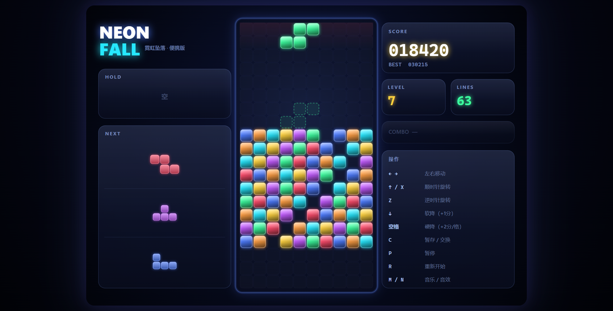

# 霓虹坠落 · NEON FALL

一个霓虹发光风格的俄罗斯方块。**单文件 HTML，零依赖，零联网，双击即玩。**

**🎮 在线玩：[wcbsxe.github.io/neon-fall](https://wcbsxe.github.io/neon-fall/)**



## 直接开玩

下载仓库后：

| 文件 | 说明 |
|---|---|
| `dist/霓虹坠落.html` | **游戏本体**，双击就行，用你的默认浏览器打开 |
| `dist/开始游戏.vbs` | 可选。用 Edge/Chrome 的**应用模式**开独立窗口（没有地址栏和标签页） |

不需要 Node、不需要构建、不需要联网。整个游戏就一个 HTML 文件。

> 想在线玩？仓库设置里打开 GitHub Pages，指向 `root` 即可（入口是 `index.html`）。

## 操作

| 按键 | 功能 |
|---|---|
| `←` `→` | 左右移动 |
| `↑` / `X` | 顺时针旋转 |
| `Z` | 逆时针旋转 |
| `↓` | 软降（+1 分/格） |
| `空格` | 硬降（+2 分/格） |
| `C` / `Shift` | 暂存（Hold） |
| `P` / `Esc` | 暂停 |
| `R` | 重新开始 |
| `M` / `N` | 音乐 / 音效开关 |

手机和平板会自动显示触屏按钮。

## 特性

- **标准 7-bag 随机器** —— 每 7 个方块为一轮，不会连续来 5 个 S
- **SRS-lite 墙踢** —— 贴墙旋转有容错，不会卡死
- **锁定延迟 480ms** —— 落地后有半秒微调时间，不是硬着陆
- **幽灵方块** —— 虚线预览落点
- **Hold** —— 存一个方块备用
- **Combo 连击** —— 连续消行有额外加分
- **等级加速** —— 每 10 行升一级，下落变快
- **程序化音频** —— 全部用 WebAudio 实时合成，没有音频文件。音效 + Am–F–C–G 琶音 BGM（118 BPM）
- **最高分本地保存** —— localStorage，换电脑就没了

### 手感参数

| 参数 | 值 | 说明 |
|---|---|---|
| DAS | 150ms | 按住方向键后，开始连续移动的延迟 |
| ARR | 42ms | 连续移动的间隔 |
| 锁定延迟 | 480ms | 落地后能继续微调的时间 |
| 重力 | `max(55, 800×0.855^(lv-1))` ms/格 | 等级越高越快，55ms 封顶 |

## 项目结构

```
neon-fall/
├── index.html              外链版入口（GitHub Pages 用这个）
├── game.js                 全部游戏逻辑（1302 行，无依赖）
├── dist/
│   ├── 霓虹坠落.html        构建产物：单文件版本
│   ├── 开始游戏.vbs         应用模式启动器
│   └── 说明.txt             面向普通玩家的说明
├── tools/
│   ├── build_singlefile.py 把 index.html + game.js 合成单文件
│   └── build_launcher.py   生成 VBS 启动器（UTF-16LE + BOM）
├── tests/
│   ├── _engine_test.html   引擎单元测试（23 条断言，浏览器里打开即跑）
│   ├── cdp_check.js        CDP 页面健康检查
│   ├── cdp_keys.js         CDP 真实键盘回归（12 条断言）
│   └── cdp_bot2.js         CDP 自动对局 bot（验证消行/升级/计分）
└── screenshots/
```

### 构建单文件版

```bash
python tools/build_singlefile.py
# → dist/霓虹坠落.html
```

脚本会检查 `game.js` 里有没有 `</script` 或 `<!--`（会提前闭合内联标签），有就报错退出。

## 测试

引擎单测直接在浏览器里打开 `tests/_engine_test.html`，跑完标题栏会显示 `ENGINE failures=N / M`。当前 **23/23 全绿**。

CDP 那三个脚本需要浏览器以调试端口启动：

```bash
msedge.exe --remote-debugging-port=9334 \
  --user-data-dir="%TEMP%\nfprof" --no-first-run \
  "file:///<你的路径>/index.html"

node tests/cdp_check.js 9334
node tests/cdp_keys.js  9334
node tests/cdp_bot2.js  9334 300
```

`cdp_bot2.js` 的参数顺序是 `port`、`MAX_PIECES`、`截图路径`。bot 用简化版 Dellacherie 评估函数（聚合高度、空洞、最大高度、凹凸度、消行奖励），实测能在真实浏览器里跑到 300 块不 game over。

## 调参

想改手感的话：

| 想改什么 | 改哪行 |
|---|---|
| 棋盘大小 | `game.js:10` — `COLS = 10, ROWS = 20` |
| 横向移动手感 | `game.js:35` — `DAS = 150, ARR = 42` |
| 锁定延迟 | `game.js:36` — `LOCK_DELAY = 480` |
| 下落速度曲线 | `game.js:346` — `function gravityFor(lv)` |
| 消行得分 | `game.js:570` — `const base = [0, 100, 300, 500, 800][n]` |

改完记得重跑 `tools/build_singlefile.py` 更新单文件版。

## 浏览器兼容

在 Edge 和夸克浏览器上实测通过（都是 Chromium 内核）。理论上任何支持 Canvas 2D + WebAudio 的现代浏览器都能跑。

`file://` 协议下 localStorage 可用，最高分会正常保存。

## 为什么没有 exe 版

最早做过一个 C# 写的 exe 启动器，但**未签名的 exe 会触发 Windows SmartScreen**（"Windows 已保护你的电脑"蓝屏），因为缺少代码签名证书和下载信誉。签名证书一年几百块，自签名证书还是会显示"未知发布者"，没有意义。

所以改成纯网页交付 —— 没有可执行文件，就绕开了这一整套检查。双击 HTML 直接进浏览器，体验上没什么损失。

## License

MIT
